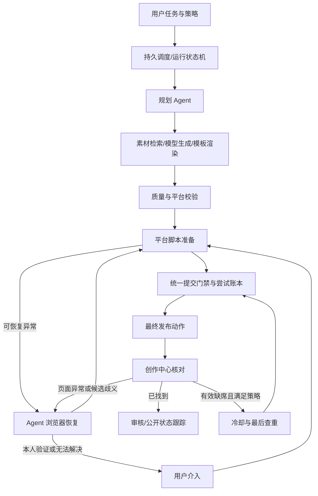

# Matrix Studio 智能体内容工作流技术调研报告

版本：1.0；日期：2026-11-11；时区：Asia/Hong_Kong。代码参考：当前工作区，Git HEAD `7197b67`，应用版本 `0.9.3`。行号仅供定位，实施时以实际代码为准。

配套文件：[02 实现规划与验收规范](./02-实现规划与验收规范.md)、[03 给实现 Agent 的交接任务书](./03-给实现Agent的交接任务书.md)。此前的[可行性报告](../智能体内容工作流可行性与技术方案-2026-11-11.md)作为背景保留；关于异常处理、提交未知与重发，以本套文档为准。

## 1. 用户目标与本次修订

用户只设置宏观任务：主题/账号定位、发布时间或周期、内容形态、平台账号、素材范围、预算、核对与重发参数。系统自动选材，调用模型和媒体工具生产内容，发布后进入创作中心确认结果。

本次明确的要求：

1. 常规步骤使用脚本，脚本异常时首先交给规划 agent 诊断和恢复。
2. agent 应有浏览器观察与操作工具，能处理弹窗、加载延迟、入口变化和可恢复的必填项问题。
3. 短信验证码、扫码及要求本人处理的验证保留给用户；其他异常由 agent 优先尝试解决，超过能力或预算才升级。
4. 发布后的核对不能停留于原页面成功提示，应进入该账号创作中心查找本次作品。
5. 多次有效检查、超过配置时间仍未发现作品时，允许按用户预设策略有限重发。
6. 重发次数、冷却时间、检查间隔等可配置，重启后计数与证据不能丢失。

旧设计“结果未知一律禁止任何自动重发”修订为“不能盲目重放最终提交；经创作中心核对和持久策略门禁后，允许创建新提交尝试”。不要求用户为每个常规恢复或已授权重发再次确认。

## 2. 可行性结论

现有 Node.js + SQLite + Playwright 足以实现，不需重建技术栈。需要新增的是可持久化工作流、模型工具循环、浏览器恢复层、作品核对层和重试策略，而不是仅向现有脚本加入一次大模型问答。

可以达成：正常路径自动运行、agent 处理可恢复异常、用户处理身份验证、跨页面查稿、有限重发、断点恢复。

不能仅靠框架保证：长期零人工、页面永不变化、平台一定准时公开、超时未找到就一定没有稿件、限制次数就一定不会触发风控。对于查无作品后的重发，存在原稿迟到造成重复作品的残余风险；系统应记录并在事后发现重复时停止后续尝试，不默认自动删除作品。

## 3. 现有代码事实

| 文件或入口 | 现有能力 | 与目标的差距 |
|---|---|---|
| `server.mjs:21`、`:25` 起 | SQLite、账号/素材/草稿/dispatch/jobs/events | 没有模板、周期运行、生成步骤、提交 attempts、创作中心观测记录 |
| `server.mjs:44` | 全局浏览器锁 | 尚无脚本/agent/人工控制权协议 |
| `server.mjs:119` | 基础素材、类型、账号和声明校验 | 缺媒体实测信息与生成质量检查 |
| `server.mjs:156` | 提交前标记、失败分类、回执落库 | 提交未知后没有主动查稿和策略重发 |
| `server.mjs:179`、`:184` | 验证监视器和串行 worker | 普通状态轮询，尚非完整上层工作流 |
| `server.mjs:354` | dispatch requestKey 去重、快照、按账号拆任务 | 只能单一内容类型，不包含多模态生产步骤 |
| `server.mjs:378`、`:382` | 抖音原页核对、未提交重试 | 已有 submitting 记录一律拒绝 retry |
| `browser-runtime.mjs:72` | 独立账号 persistent context、编辑页 | 可复用，但不能开第二个进程争用相同 Profile |
| `browser-runtime.mjs:112` | 同账号独立身份检查页 | 可参考其模式增加作品核对页，不能覆盖原提交页 |
| `browser-runtime.mjs:257`、`:315` | prepare/submit、身份/文案/声明复核 | 无模型驱动恢复，最终动作需接统一门禁 |
| `browser-runtime.mjs:357` | 抖音原页成功观察 | 依赖内存 pendingSubmissions，不支持跨平台查稿、重启后独立查稿 |
| `platform-catalog.mjs` | 静态平台×类型目录 | 不能代表自动提交或自动查稿已验收 |
| `publication.mjs` | 发布方式、静默、AI 声明 | 没有 recovery/verification/retry 策略 |
| `public/app.js` | 状态展示、手工处理按钮 | 缺运行进度、恢复过程、查稿证据、重发设置和计数 |

其他重要限制：`content.versions` 主要按平台覆盖标题正文，不能完整表达同平台多个账号的不同成品；富文本通过系统剪贴板粘贴，发布并发时会有跨任务覆盖风险；素材删除和账号删除的终态判定需随新增监控任务一起调整。

当前知乎视频和 B站文章的默认通用 submit/success 配置不完整，不能因为列在平台目录中就计为自动发布可用。专用流程需阅读专用代码，不能反过来仅因配置字段为空就判定没有实现。

## 4. 推荐架构与选型

第一版采用一个规划 agent，具有结构化业务工具和浏览器恢复工具；多个“角色”是逻辑模块，不强制多个独立 agent。固定状态机控制时间和副作用，模型负责不确定性判断。

| 技术点 | 首版选择 | 以后再考虑 |
|---|---|---|
| 调度与步骤状态 | SQLite 持久状态机，定时扫描到期记录 | 多机器时采用专业队列或工作流引擎 |
| 模型 | 供应商无关 gateway，结构化输出，真实服务 + 测试 fake | 多供应商路由、自动降级 |
| 浏览器 | 复用现有 Playwright context；语义定位优先、截图补充 | 经实测再引入专用浏览器 agent SDK |
| 素材检索 | 标签、SQLite FTS5、OCR/转写摘要 | 必要时增加向量索引 |
| 图文生产 | 现有图片 + 程序模板排版 | 需要新图时调用图片模型 |
| 视频生产 | 镜头表 + FFmpeg + ASR/TTS | 全生成视频、复杂运镜 |
| 外部调用协议 | Node 服务方法 + schema 工具注册 | 需要外部 agent 时增加 MCP；MCP 不承担调度 |

Playwright 官方支持同一 context 多页面和语义 locator，适合复用账号登录态与原发布页 [R1][R2]。LangGraph 的持久化与 interrupt 可作为可选运行时，非首版必需 [R3]。即使引入 BullMQ，重试仍需业务保证幂等 [R4]。

## 5. Agent 恢复与控制权

异常必须形成结构化 RecoveryContext：任务/账号/attempt、当前阶段、错误类别、已完成动作、是否已进入最终提交边界、允许操作、页面 token、脱敏观察证据。

模型采用“观察 → 选择一个工具动作 → 执行 → 验证”的受限循环。完成填写后返回标准适配器重新核对；不允许模型只说“修好了”就视为成功。新发现的定位规则可形成待验证候选，不直接改写生产适配器或执行任意代码。

| 异常 | 首选处理 | 升级条件 |
|---|---|---|
| 加载未完成、临时网络错误 | 有上限的等待、在允许阶段重载 | 超过恢复预算 |
| 普通提示、遮挡、可识别弹窗 | agent 观察后关闭或确认并复核 | 操作含义不明确 |
| 已授权字段缺失、分区等未选 | 从任务资料与许可值中补全 | 缺少事实或无允许值 |
| 定位变更 | agent 语义/视觉定位，恢复后走原校验 | 无唯一操作目标 |
| 短信、扫码、安全挑战 | 显示原会话并暂停，等待本人处理 | 超时后保持待处理，不循环重发 |
| 身份不一致 | 程序阻断该账号写入 | 需恢复指定账号，不让模型改绑 |
| 内容违规拒绝 | 记录原因，按已授权内容修订策略处理 | 无修订授权或不可恢复拒绝 |
| 已进入最终提交后异常 | 转作品核对 | 不通过普通恢复动作重复点击发布 |

控制权包括 `script/agent/human/verifier`，一次只有一个 owner。观察结果、页面 token 和动作都带 leaseVersion，防止模型在旧截图上操作新页面。验证码出现后工具层屏蔽敏感输入与页面内容，不读取、不保存验证码。

“agent 可操作浏览器”不等于任意坐标和任意 JS 不受限。最终发布、确认发布弹窗、Enter 导致的表单提交等都必须归入受控提交动作；无法判定按钮是否产生最终提交时暂停诊断。只靠提示词要求“不点发布”不足以保障计数。

## 6. 创作中心作品核对

每个平台实现可独立测试的 verifier：识别正确账号，打开内容管理，识别已发布/审核中/定时/草稿/失败等实际可见状态，按时间范围查找候选并打开详情。不同平台缺少某标签时以真实页面为准，不能编造选择器。

每次提交前记录近期作品 baseline；提交后按外部稿件 ID 优先，其次按“新增作品 + 账号 + 类型 + 时间 + 标题/正文/封面/时长”等组合关联。平台标题归一化、封面转码和时间精度差异需要单独适配；没有合法唯一依据时返回 ambiguous。模型评分可帮助排序，不单凭模型 confidence 数值做最终关联。

观测结果至少分为：

- `found_published`：找到匹配稿件，后台标记已发布；另记 publicVisibility 是否经过核验。
- `found_reviewing` / `found_scheduled`：已经存在稿件，不能因尚未公开就另建同稿。
- `found_draft`：草稿存在，不证明最终提交成功；优先恢复原草稿，最终提交仍记新 attempt。
- `found_rejected`：明确审核拒绝，区别于网络提交失败。
- `absent_valid`：页面完整、账号正确、时间窗和相关范围检查充分、没有唯一/模糊候选。
- `inconclusive` / `ambiguous` / `requires_human`：无有效缺席证据，不计入缺席检查次数。

后台“已发布”与匿名公开可见不是同一事实，UI 分开呈现；如平台要求只通过登录态访问，不强制匿名验证。稿件正在审核、限制展示或定时等待时，不能将公开不可见当作未发送。

## 7. 有限重发策略

用户可在任务级配置重发策略，策略在每次运行时快照固定；本次用户已经要求该能力，不增加逐次确认流程。新建任务界面可预填 `maxResends=2`、允许有效缺席超时重发；用户保存任务后生效。历史任务不自动继承新重发权限，使用次数 0 的保守迁移策略。

一次 release intent（本次运行 + 一个账号 + 一个发布内容槽位）包含所有 attempts；最多最终提交动作次数为 `1 + maxResends`。每次可能发生最终提交的动作先占用名额；即使点击超时也不退还，以防进程中断漏计。填写、只读核对和纯渲染重做不消耗该名额，但各有恢复/生成预算。

有效缺席重发必须同时满足：已等待缺席窗口、完成足量有效且间隔合理的检查、没有关联稿件/歧义候选、没有待本人完成的验证、账号一致、未超次数和截止时间、冷却到期、最后一次新鲜查重通过。列表筛选失效、只看第一页但覆盖不足、页面报错，都不能算有效缺席。

缺席窗口从最近一次 attempt 的提交边界开始；新 attempt 重置该 attempt 的缺席检查序列，不重置 release intent 的次数和总截止时间。冷却采用任务快照中的递增间隔；这些间隔是产品参数，不宣称平台安全阈值。

若旧 attempt 的作品延迟出现，取消尚未开始的新 attempt；若后一次也已提交，标记 duplicate_suspected，停止继续重发，列出候选供核对，不默认删除。平台审核中超过观察期限进入超时/待诊断，不转为“缺席重发”。

## 8. 内容生成与调度全链路

素材入库：真实格式/哈希/ffprobe → OCR、关键帧/转写 → 标签/来源/使用许可 → 索引。选择先硬筛素材范围、媒体质量、授权和复用冷却，再让模型排序。视频使用带时间戳的片段，而非凭文件名生成剪辑。

长文保留事实资料 ID/引用，派生 HTML 和纯文本；图文使用结构化卡片布局；视频由模型产出受 schema 约束的镜头表，程序编译媒体命令。生成物回库并保留 lineage，按账号生成完整 artifact，避免仅替换标题却复用错误媒体。

模型网关保存远端异步 task ID、输出、成本和版本；请求超时先核对远端任务，避免重复付费。任务预算、修订轮数和模型失败策略持久化。未配置真实模型时只允许显式 demo，不用 mock 冒充真实创作。

任务时区使用 Asia/Hong_Kong，持久保存 UTC 目标时刻；提前生产，到发布窗口提交。电脑离线、休眠、逾期任务按预设 skip/window/latest 策略补偿，不能将积压全部瞬间发送。当前全局浏览器锁可保留，等待模型和冷却时释放锁，单次浏览器动作短时领取；第一版不要求多账号并发。

## 9. 平台能力与外部边界

| 平台 | 工程路线 | 未完成验证 |
|---|---|---|
| 抖音 | 现有浏览器视频发布 + 新创作中心 verifier；获批后可加 API | 官方 API 要求 video.create 授权及代发操作感知 [R5]；实际账号页面、权限、列表状态需联调 |
| 小红书 | 现有图文/视频脚本 + 新 verifier | 官方分享 SDK 依托 App，不能等同后台无人值守 API [R6] |
| 知乎 | 当前文章浏览器路线 + 新 verifier；官方定向工具另行评估 | 官方 ZhihuSync 定向授权、预览确认、暂不支持视频 [R7] |
| B站 | 当前视频脚本 + 新 verifier；视频/专栏 API 可作为获批路线 | 开放权限、真实稿件状态、文章通道需联调 [R8][R9] |

不要通过更换浏览器方式推断平台规则已经满足。平台规则核验是通道接入条件，不要求实现 agent 为每次普通自动恢复再索取许可。

## 10. 风险、验证与交付边界

重点验证：错账号、页面不完整却误判缺席、审核中误重发、迟到重复、脚本与 agent 竞争控制、请求重放绕过计数、重启计数归零、内存页面引用丢失，以及新监控状态下素材/账号被提前删除。

本套文档只交付设计与实现计划，未接入模型、未开发 verifier、未新增真实发布任务。本对话此前执行基线检查：npm run check 通过，npm test 107/107 通过（受控页面，约 68 秒）；不代表新增设计已实现或真实平台验收。当前文档阶段不为凑数重复运行相同代码测试。

## 11. 官方参考与证据级别

以下均于 2026-11-11 调研；区分“官方文档存在”“账号获批”“代码实现”“真实账号验收”，不能互相替代。B站与小红书部分页面依赖动态渲染，使用官方站点可检索摘要，实施时必须重新查实际页面。

- [R1 Playwright BrowserContext](https://playwright.dev/docs/api/class-browsercontext)：同会话多页面基础。
- [R2 Playwright Locators](https://playwright.dev/docs/locators)：语义定位基础。
- [R3 LangGraph Interrupts](https://docs.langchain.com/oss/javascript/langgraph/interrupts)：可选持久暂停/恢复。
- [R4 BullMQ Idempotent Jobs](https://docs.bullmq.io/patterns/idempotent-jobs)：重试的业务幂等要求。
- [R5 抖音创建视频](https://open.douyin.com/platform/resource/docs/openapi/video-management/douyin/create/create-video/)：授权、代发感知、审核。
- [R6 小红书分享平台](https://agora.xiaohongshu.com/doc)：App 分享路线。
- [R7 知乎官方 ZhihuSync](https://github.com/zhihu/ZhihuSync)：定向授权及当前支持形态；仅调研，没有安装执行该 skill。
- [R8 B站开放文档](https://openhome.bilibili.com/doc)：视频管理能力目录。
- [R9 B站文章稿件投递](https://open.bilibili.com/doc/4/b14b77b6-8889-8c8b-2e83-17c5a4c550fb)：ATC_BASE 文章投递路线。
- [R10 FFmpeg Filters](https://www.ffmpeg.org/ffmpeg-filters.html)：媒体合成实现参考。
- [R11 阿里云视频生成 API](https://help.aliyun.com/zh/model-studio/wan3-video-generation-api-reference)：异步模型任务示例，不代表已选定服务商。

本报告的架构、参数示例、匹配条件和工程量均为项目设计判断，不是平台承诺。
