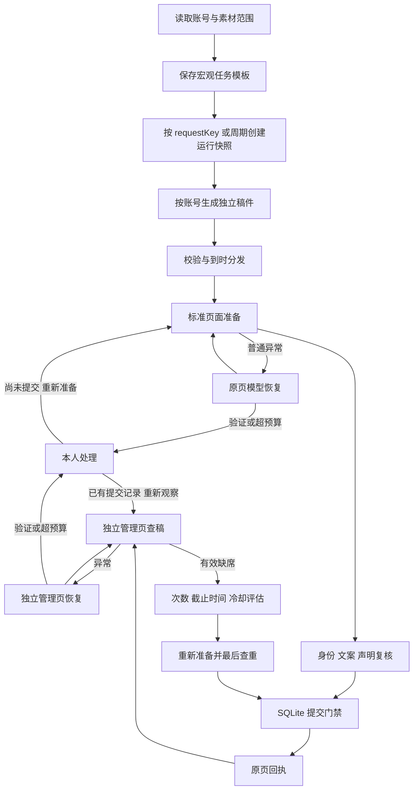

# Agent 工作流与接口

更新日期为 2026-11-12。当前 HTTP 服务和进程内 agent 工具共用模板服务、运行服务、发布动作服务与持久提交门禁。

## 工作流



同一个发布任务贯穿首次提交、查稿和有限重发。修改 requestKey 或创建另一模板运行不是对原发布任务的恢复手段。恢复和重发都使用原账号及成品。本人处理前若没有提交记录，完成后重新准备；已有提交记录则先查稿。

## 接入方式

HTTP 仅允许本机与同源访问。写接口沿用 X-Studio-Token，前端从 GET /api/state 获取当前服务令牌。外部 agent 作为已授权的本机客户端使用该令牌，权限与工作台用户相同。运行时内部模型仍使用特定账号页面的一次性动作列表。

GET /api/agent/tools 返回工具名称、说明和 JSON Schema。POST /api/agent/actions 请求格式如下。

```json
{"name":"verify","arguments":{"id":"原job_id","expectedVersion":3}}
```

成功响应为 {"ok":true,"result":...}。失败响应为 {"error":"可读原因","reasonCode":"结构化代码"}，状态码使用 404、409、422 等。调用方从 publication 或运行详情取得最新 version 后再发起发布动作。页面与账号身份、候选作品、覆盖范围和 absence 结果只接受内部核对服务产出。

createStudio 返回 agentTools，其中 list() 与 execute(name, arguments) 复用相同业务服务，便于集成本地规划 agent。工具执行为同步提交业务意图，耗时生成、浏览器恢复和核对由 worker 处理。调用方应读取运行与发布状态判断实际完成情况。

## 工具目录

|工具|输入要点|结果|
|---|---|---|
|context|空对象|可用账号、素材元数据、查稿规则与模型配置是否存在|
|templates|空对象|已保存模板及版本|
|save_template|spec、enabled，更新时 id、expectedVersion|模板 id、version|
|run_template|id、requestKey|运行 id、reused|
|run|id|运行快照、成品、分发任务与发布账本|
|stop_run|id|停止尚未分发的目标，保留已分发目标|
|resume_target|id、targetId|仅恢复可安全重试的阻断目标|
|publication|id|owner、version、策略、attempts、上次核对与恢复预算|
|verify|id、expectedVersion|安排只读核对，或返回节流结果|
|recover|id、expectedVersion|提交前安排标准恢复；提交后先核对|
|request-retry|id、expectedVersion|评估已有证据并安排核对，后续最终查重与提交仍经过门禁|
|human-completed|id、expectedVersion|提交前重新观察准备；提交后重新查稿|
|stop|id、expectedVersion|停止后续自动动作；提交记录与计数保留|

工具目录包含业务动作。最终点击仍从提交门禁执行；恢复动作使用内部受控页面能力，不能传入任意脚本、按钮选择器、Shell、凭证或平台账号身份。

## 对应业务 HTTP 接口

模板和运行沿用 POST /api/task-templates、POST /api/task-templates/{id}、POST /api/task-templates/{id}/run、GET /api/runs/{id}、POST /api/runs/{id}/stop、POST /api/runs/{id}/targets/{targetId}/resume。

GET /api/publications/{id} 读取发布状态。POST /api/publications/{id}/verify、recover、request-retry、human-completed、stop 都只接受 {"expectedVersion":整数}。HTTP 返回发布状态并附 reasonCode。旧的 /api/jobs/{id}/retry 保留原提交后防重限制。核对历史由 GET /api/publications/{id}/observations 分页读取。

verify 请求按上次检查时间节流。未启用持续核对的任务可以请求一次只读检查，完成后停止安排下一次。recover 在提交前检查模型配置、运行时能力和阶段；已有提交尝试则先核对，不能由此直接再点发布。stop 可以停止提交前任务、模型等待和查稿；新 final action 会在门禁中再次检查停止标记。

常见 reasonCode 包括 version_conflict、owner_busy、missing_model、unsupported_recovery、unsupported_verifier、needs_human、not_submitted、retry_disabled、limit_exhausted、outside_window、candidate_found、check_throttled。HTTP 409 表示应重新读取状态、补齐配置或等待人工处理；不能通过换任务键绕过。

## 当前验证与剩余工作

工具目录、HTTP 门禁、幂等运行、过期版本拒绝、恢复配置缺失、主动检查节流和调用方伪造缺席拒绝均有受控测试。视频费用与真实万相调用按用户要求记入 TECH_DEBT.md。真实平台管理页规则、生产模型规划质量及长期运行仍需对应环境验收。
本轮 npm run check 通过，npm test 完整回归 156/156 通过；未执行付费视频生成与真实平台发布。
