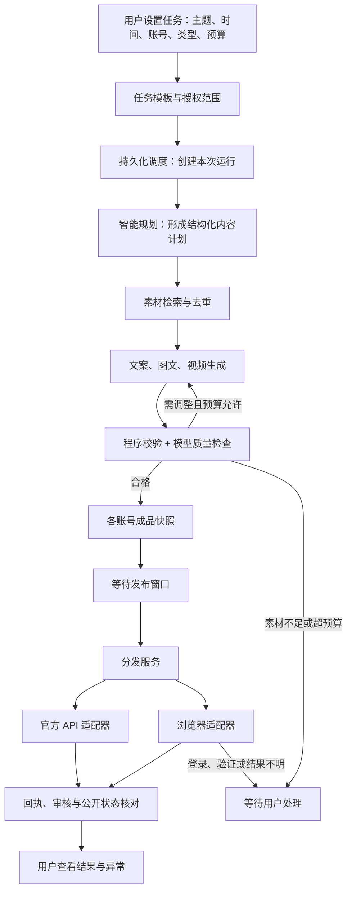

# Matrix Studio 智能体内容工作流可行性与技术方案

> 更新：用户随后明确要求 agent 优先恢复普通异常、创作中心查稿、超时后可配置有限重发。对应最新规范见 [智能体工作流技术调研报告](./agent-workflow/01-技术调研报告.md)、[实现规划与验收规范](./agent-workflow/02-实现规划与验收规范.md) 和 [Agent 交接任务书](./agent-workflow/03-给实现Agent的交接任务书.md)。本文保留为首轮调研背景；关于 unknown 一律不自动重发、异常直接转人工等较保守表述，由新规范替代。

调研日期：2026-11-11（Asia/Hong_Kong）。依据：当前工作区源代码、README、测试，以及文末官方公开资料。本报告描述设计方案，没有接入模型、创建定时任务或向真实账号发布内容。接口文档可访问不代表当前账号已获权限。

## 1. 结论与目标边界

这条路线可行，而且适合在现有项目上增量建设。建议将 Matrix Studio 定位为“智能内容任务工作台 + 可恢复的工作流 + 平台发布执行器”。用户设置目标、时间、内容类型、账号和预算；智能体理解任务、选材、创作和生成平台版本；程序负责调度、校验、账号核验、最终提交和结果核对。

推荐实现的是“正常路径自动完成，登录、平台验证、质量不达标和结果不明时才交给用户”。目前没有依据承诺四个平台长期零干预、准时公开、永不重复发布。

可行性分层：

| 目标 | 判断 | 前提或限制 |
|---|---|---|
| 定时选材、生成长文、生成图片笔记 | 高 | 素材有可理解的元数据；模型结果有结构化校验 |
| 现有素材剪辑为短视频 | 高 | 先限定模板、比例和时长；由媒体程序完成渲染 |
| 全部镜头由视频模型生成 | 可行，波动较大 | 生成时间、成本、连续性和失败重做难预测 |
| 自动填写并提交平台 | 有条件可行 | 官方接口权限或已验收的浏览器适配器 |
| 定时“公开可见” | 无法严格保证 | 平台审核、排队和账号风控不由本工具控制 |
| 用户长期完全不介入 | 不宜作为当前承诺 | 扫码、短信验证、定向授权、异常结果仍可能需要用户 |

“定时”建议明确为目标提交时间和允许延迟窗口；公开可见时间单独记录。如果平台支持并允许预提交定时稿件，可进一步提前上传与设置平台定时。

## 2. 项目现状：能复用什么，缺什么

项目为 Node.js ESM、本地 HTTP 服务、SQLite 和 Playwright，前端无应用构建框架，富文本基于 Tiptap。已有内容类型是 `video`、`article`、`note`。

| 领域 | 源代码已具备 | 距目标的主要缺口 |
|---|---|---|
| 账号 | 独立 Chrome Profile、扫码登录、本人身份核验、错号阻断、会话复用 | 任务级账号授权范围、API OAuth 凭证与续期、能力探测 |
| 素材 | 上传、本地存储、按日期/名称/类型筛选、引用保护 | OCR、视频理解、语音转写、标签、语义检索、版权与使用历史 |
| 内容 | 草稿、文章 HTML、平台专属标题和正文、视频与封面引用 | 自动创作、版本评估、每账号差异化、生成素材回库 |
| 分发 | 内容快照、按账号拆 jobs、requestKey 去重、队列 | 上游任务模板、每次定时运行、提前生成、失败策略 |
| 发布 | 多平台专用适配、AI 声明处理、人工接管、部分成功提示读取 | 完整必填项、真实账号验收、稿件查询、审核和公开状态追踪 |
| 持久化 | 草稿/任务/事件落库，重启恢复，提交不明不重发 | 执行租约、阶段检查点、生成成本账本、跨服务事务衔接 |
| 智能体 | 已有可供工具化封装的 HTTP 接口和业务方法 | 无模型调用层、无 agent 工具协议、无智能规划循环 |

关键源代码证据：

- `server.mjs:21` 起创建本地服务与数据表；`accounts/assets/drafts/dispatches/jobs/events` 可保留作为基础。
- `server.mjs:44` 的 `lockBrowser()` 是全局浏览器锁；`server.mjs:184` 起的 worker 也是全局串行，不能按账号数直接推算并发吞吐量。
- `server.mjs:119` 起 `validate()` 检查类型、账号、素材、封面与声明，尚无真实编码、时长等完整媒体校验。
- `server.mjs:156` 起 `submitReal()` 在最终点击前记录提交事件，提交不明进入 `unknown`；这项约束应该保留。
- `server.mjs:354` 起 `/api/dispatch` 用 `requestKey` 去重并保存不可变快照，适合接在生成工作流之后。
- `browser-runtime.mjs:199` 起 `PublishAdapter` 已分开 `prepare/submit/checkResult`，可演进为统一发布接口。
- `browser-runtime.mjs:315` 起最终提交会再次核对身份、文案、声明和必填项。
- `platform-catalog.mjs:1` 是静态内容类型矩阵，不代表每条路线已能最终提交。

需特别注意的三个现有限制：

1. 一个 dispatch 只有一个 `content.type`，同一主题不能直接在同一个 dispatch 中既发知乎长文，又发小红书图文和抖音视频。应新增上层 `workflow_run`，按内容形态/成品拆成多个 dispatch。
2. `content.versions` 当前以 platform 为键，且主要覆盖标题和正文；不能完整表达同一平台多个账号使用不同图片、封面、视频、话题、声明。应引入每目标账号的完整 publication artifact，或先逐账号单独 dispatch。
3. 知乎视频、B站文章虽出现在能力目录，但配置中的通用 `submit/success` 仍为空，且不走已有专用提交流程；默认状态下不能将它们算作已经完成自动发布。抖音、小红书、B站视频和知乎文章有专用代码，不能仅因其配置中部分值为空就判定完全未实现。

当前 README 记载了多轮真实页面准备修复，并明确多处最终投稿未执行、账号级验收待完成；测试中的真实 Chromium 多数操作的是拦截页面或构造页面。需要区分“浏览器运行真实”“页面结构来自真实页面”和“真实账号投稿成功”。

## 3. 平台路线核验

以下为公开文档支持的路线，不等于已经完成应用申请或账号验证。

| 平台 | 官方能力与限制 | 本项目建议 |
|---|---|---|
| 抖音 | 有创建视频接口，`video.create` 需申请并经用户授权；文档要求每次代用户创建视频时让用户明确感知操作；创建后还有审核过程 [S1][S2] | 并行核验应用权限及“用户感知”的可接受产品设计；已有浏览器视频路线作为权限获批前的试点，但仍需确认使用规则 |
| B站视频 | 官方开放平台列有视频发布/删除/查询，单稿查询文档使用 `ARC_BASE` [S3][S4] | 有权限优先 API；已有网页视频适配器保留，补必填分区、标签和回执 |
| B站专栏 | 官方文章投递接口 `/arcopen/fn/article/add`，`ATC_BASE` 需申请并经用户授权 [S5] | 应优先验证专栏 API；当前网页文章路线不能视为自动提交可用 |
| 知乎 | `zhihu` 官方组织下的 ZhihuSync（旧 ZhihuPublisher 地址重定向）支持文章/提问/想法；定向开放授权，当前不支持视频，官方工具流程包含预览与用户明确确认 [S6] | 先验证账号申请资格；若复用官方工具，保留其当前确认步骤；自研定时 API 接入需另核验平台规则，不能假定允许无确认后台发文 |
| 小红书 | 官方分享平台可分享图文/视频，但基于 App 内发布能力；JS SDK 是分享至 App 的流程 [S7][S8] | 分享能力不能直接等同服务端无人值守发布；现有浏览器路线最便于小范围验证，长期自动化稳定性和允许范围需独立验收 |

本次没有拿到四个平台的实际开发者后台权限列表、应用审核结果、账号配额或商业合作协议。B站与小红书部分文档依赖动态页面，已用官方站点搜索摘要交叉核验；仍须在申请和开发时复核后台可见文档及实际返回值。

不要用“第三方工具能发”推导“有普遍开放的官方 API”，也不要用“公开文档没找到”推导“绝对不存在合作接口”。发布方式应逐平台、逐账号、逐内容形态选择。

## 4. 推荐架构



第一版只需要一个可调用工具的规划器，配合固定工作流节点，不需要先搭建多个彼此对话的 agent。智能体负责存在不确定性的判断：选题、选素材、写作、镜头安排和改写。程序负责确定性约束：状态迁移、时间、预算、账号、资源访问和提交次数。

### 4.1 用户任务应如何描述

用户设置的宏观任务之外，还需要账号定位和内容边界，否则智能体只能随机猜测。建议首轮配置账号受众、语气、品牌资料、禁止事项、事实来源、素材可用范围和预算；后续任务可复用。

示例（目标产品的配置格式，尚未实现）：

```json
{
  "name": "工作日产品内容分发",
  "topic": "围绕资料库中的产品功能与使用案例",
  "schedule": {
    "cron": "0 18 * * 1-5",
    "timezone": "Asia/Hong_Kong",
    "meaning": "target_submit_time",
    "prepareLeadMinutes": 60,
    "latePolicy": "skip_after_window",
    "allowedLatenessMinutes": 30
  },
  "targets": [
    {"accountId": "xhs-account-a", "type": "note", "styleProfileId": "practical"},
    {"accountId": "zhihu-account-a", "type": "article", "styleProfileId": "explanatory"},
    {"accountId": "douyin-account-a", "type": "video", "styleProfileId": "short-demo"}
  ],
  "assets": {"collectionId": "product-a", "reuseCooldownDays": 14},
  "generation": {"videoMode": "template_edit", "maxRevisionRounds": 2},
  "budget": {"currency": "CNY", "maxPerRun": 20},
  "releasePolicy": "auto_if_platform_allows_and_checks_pass"
}
```

预算金额只是字段示例，不是成本报价。定时任务保存具体账号 ID，任务执行时不能由模型自行改选其他账号。平台不支持某形态时应在保存配置时明确处理，不自动把视频降级成图文或擅自换平台。

### 4.2 智能体如何借助此工具

优先做服务层 + 结构化工具接口，直接复用项目业务逻辑。避免让智能体每次通过截图点击本工作台完成业务操作；页面适配负担应集中在各平台执行器。

可先在 Node 进程内部提供工具调用，后续按需要加 MCP 或 REST 网关。MCP 是可选的协议封装，不承担持久调度和发布一致性。

建议工具集合：

| 工具（拟新增） | 输入/输出要点 |
|---|---|
| `list_target_capabilities` | 返回已授权账号及各形态的可用通道、验收状态与必填项 |
| `search_assets` | 范围、主题、类型、使用历史；返回候选 ID、摘要和匹配依据 |
| `get_asset_context` | OCR、转写、关键帧摘要、许可范围和可用片段 |
| `generate_content` | 任务计划、事实资料、平台约束；输出结构化文稿 |
| `render_artifact` | 图片排版或视频编辑计划；返回成品素材 ID |
| `validate_artifact` | 返回明确问题、是否可发布和需要修订的字段 |
| `dispatch_publication` | 运行 ID、目标账号、不可变成品 ID、幂等键 |
| `get_run_status` | 运行状态、任务状态、成本、回执和待处理原因 |

以上名称都是设计接口，当前项目没有这些 agent 工具。现有 `/api/state`、`/api/assets`、`/api/drafts`、`/api/validate`、`/api/dispatch` 可作为实现基础。

现有令牌是本地工作台的会话写入令牌，不是可直接对外暴露的长期 agent 授权。工具层应限制任务授权的账号、素材集合、调用预算和有效期；模型拿到业务 ID 和摘要，凭证由执行器管理。模型生成内容、素材 OCR 和外部网页都属于数据，不能成为更换账号、读取凭证或绕过发布检查的命令。

## 5. 素材库从“文件列表”升级为“可选择的素材知识库”

建议增加异步入库流程：

1. 计算 SHA-256，识别真实文件格式，用 ffprobe 读取时长、编码、分辨率、帧率和音轨。
2. 图片生成 OCR、内容描述、主体和构图信息；视频提取关键帧/镜头，音轨转写并保存时间戳。
3. 保存主题、产品、人物、适用平台、横竖屏、来源、授权范围和有效期。模型推断标签不能替代可核验的授权信息。
4. 将描述、转写和资料文本建立全文索引；需要按语义检索时再增加向量索引。先做 SQLite FTS5 和人工标签，避免一开始引入额外向量数据库。
5. 选择素材时先按授权、类型、清晰度、日期和使用冷却期硬筛，再对候选排序；模型基于候选 ID 选取并输出理由。
6. 为视频保留可用时间段，生成剪辑计划时引用 `assetId + startMs + endMs`，而不是让模型凭文件名猜镜头内容。

增加 `asset_usage` 记录“哪次运行、哪个账号、哪个成品使用过”，支持跨天去重、账号差异化和素材消耗统计。素材不够时等待补充或采用用户预先允许的替代策略，不默认重复发昨天的内容。

## 6. 三种内容生产方案

### 6.1 图片笔记

素材检索 → 提炼主题 → 结构化标题/正文/配图顺序 → 模板生成封面与信息卡 → 视觉校验 → 成品回库。

第一阶段优先用现有照片和产品图，使用 HTML/CSS 模板经独立渲染进程导出 PNG；复杂图片处理可接入图像库。中文标题、价格、参数由程序排版，降低图像模型写错字的概率。需要新插画时再调用图片模型。检验文字溢出、遮挡、重复图片、主图可读性、图片数量和比例。

### 6.2 长文章

资料检索 → 带来源的大纲 → 分节撰写 → 检查数字/引用/产品事实 → 标准内容树 → 目标平台 HTML 或 API 内容结构。

建议保留一个内容树作为事实源，派生正文纯文本与 HTML，复用当前 `cleanHtml()` 和富文本检查。每项关键事实关联资料 ID 或来源链接；第二次模型审核只能辅助检查，不能代替事实依据。正文插图应转换为平台允许的图片资源，不能假定所有平台都接受 data URL。

### 6.3 视频

推荐先做“现有素材智能剪辑”：

```text
已有视频/图片 → 脚本和镜头表 → 片段选择 → 配音/字幕
→ FFmpeg 合成 → 封面与多比例版本 → 抽帧/试听/媒体校验 → 回库
```

FFmpeg 提供拼接、缩放、字幕和混音等基础能力 [S9]。第一版限定一种视频模板、固定时长区间和一种主比例，再逐步增加平台版本。音频也需要纳入素材管理；当前素材界面以图片/视频为主，应补配音、音乐等资产类型及其使用许可。

模型应输出受 schema 约束的编辑计划，由程序编译成 FFmpeg 参数；不执行模型生成的任意 shell 命令。媒体渲染放到独立进程/worker，避免阻塞 HTTP 和调度。

全生成视频适合作为后续可选分支。以阿里云万相视频 API 为例，公开文档提供异步生成机制 [S10]；接入时应保存远端任务 ID，按退避策略查询，完成后将结果下载入素材库并校验。远端请求超时不能直接认定任务未创建，也不能无限重建付费任务。具体模型、地域、商用条件和计费通过实际账号单独评测，不将某个模型版本写死到业务层。

建议模型网关统一处理文本、视觉、图片、视频、ASR/TTS 的供应商差异，记录 model/version、输入摘要、输出资产、耗时、成本和远端任务 ID。先接一种文本/视觉能力与模板渲染，不必首期同时集成多家模型。

## 7. 调度、恢复与发布一致性

### 7.1 状态与数据

建议保留当前表，增加：

- `task_templates`：用户意图、时间规则、允许账号、素材范围、预算、版本。
- `workflow_runs`：每个计划时刻的运行，记录任务版本、目标时间、状态和总成本。
- `step_runs`：规划、检索、创作、渲染、校验等步骤的输入输出、重试与检查点。
- `asset_metadata/asset_usage`：素材理解、来源和复用记录。
- `artifacts`：各平台/账号的正文、封面、媒体及生成来源。
- `model_tasks/cost_ledger`：外部模型任务与费用，避免重复付费。
- `submission_attempts`：最终提交尝试、目标账号、通道、证据、外部稿件 ID。
- `outbox`：将本地状态变更与待发送动作一并提交，减少进程中断造成的漏分发。

上游状态可为 `scheduled → planning → selecting → generating → validating → ready → waiting_publish_window → dispatching → monitoring → completed`。异常另设 `needs_input/blocked/failed/cancelled`。

发布状态继续区分 `prepared/submitting/submitted/reviewing/published/rejected/unknown`。用户看到的“完成”必须附带已达到的状态；没有公开状态证据时只能报“已提交，公开状态未核验”。

### 7.2 幂等与重试

每次运行使用唯一 `(taskId, scheduledFor, taskVersion)`，每个目标使用独立幂等键；相同主题每天合法的新任务不能被内容哈希全局去重。单独做近期内容相似度检查。

当前 requestKey 重用时直接返回原 dispatch；应补充相同 key 的输入哈希比对，输入不一致返回冲突，避免 agent 误用旧 key 却以为新内容已创建。

重试规则应按步骤区分：

| 操作 | 自动重试原则 |
|---|---|
| 资料读取、检索、渲染 | 可有限重试，保留检查点 |
| 模型创作 | 有预算与轮次限制；已成功结果复用 |
| 付费异步生成提交 | 先核对远端任务，支持时使用供应商幂等键 |
| 平台填写/上传 | 确认未最终提交时才允许恢复 |
| 平台最终提交 | 无可靠平台幂等能力时，不自动重放结果不明的动作 |
| 回执/审核查询 | 只读、有退避和截止时间，可重复查询 |

本地事务、队列和工作流引擎无法替外部平台承诺“恰好发布一次”。浏览器最终点击和本地记录之间存在无法原子提交的窗口；应先写提交尝试，再发动作，随后查回执。窗口内异常可能导致需要人工核对，这是为了避免重复稿件而有意保留的不确定状态。

### 7.3 定时的实际含义

保存时区与 UTC 目标时刻，提前生成；服务重启后扫描遗漏时刻，按用户预设选择跳过、窗口内补发或只补最新一期。默认不应把关机几天积压的全部稿件瞬间发出。

增加账号频率限制、同账号串行、运行租约和心跳。第一版可保留全局发布串行，仅让素材解析和生成并行；需要并发发布时，再将全局锁改成账号锁并设浏览器总并发上限。当前富文本流程使用 Windows 系统剪贴板，即使账号隔离也可能相互覆盖；并行前需保留全局剪贴板锁或替换输入方式。

Windows 本地运行建议使用专用常驻用户会话，配置进程守护和重启恢复；抖音可见窗口、扫码和人工验证意味着不能简单迁到无交互的 Windows 服务中就认为可用。电脑关机/休眠时无法执行。若采用云端编排 + 本地浏览器 worker，由本地主动建立出站连接领取任务，不直接暴露 4318 端口；Profile 和会话凭证留在本机。

## 8. 技术选型与取舍

| 方案 | 适用范围 | 本项目判断 |
|---|---|---|
| Node + SQLite 持久状态机与调度 | 单机、低频、少量账号 | 第一版推荐；依赖最少，复用最多，但需要自行实现租约、补偿和检查点 |
| LangGraph + 持久 checkpointer | 需要多轮规划、工具路由、暂停恢复 | 可选用于智能决策子流程；它的持久化能力不替代平台提交幂等 [S11] |
| BullMQ + Redis | 需要独立生成/渲染 worker 和队列并发 | 第二阶段可选；官方有 Job Schedulers 与幂等设计说明，队列重试仍要求业务自行保证幂等 [S12][S13] |
| Temporal + PostgreSQL | 多机器、长流程、多团队运行 | 后期可选；提供可恢复执行和调度，但引入部署与运维成本，外部提交仍需设计 [S14][S15] |
| 外部可视化编排器 + 本项目 API | 已有编排平台，希望快速验证串接 | 可用于验证，不建议同时建立两套发布状态和重试控制 |

不必同时上 LangGraph、BullMQ、Temporal。第一版用可读的固定步骤和结构化工具调用即可；将步骤接口设计清楚，后续可以更换编排运行时。

## 9. 建议实施路径

以下是工程量粗估，假定一名熟悉该项目的开发者、可及时使用真实测试账号、模型服务已可申请；不包含平台权限审批与账号风控等待，也不是交付承诺。

| 阶段 | 交付物 | 参考投入 |
|---|---|---|
| 0：路线验证 | 核对真实账号发布状态、四平台权限；选定首个闭环 | 2–4 人日 |
| 1：单一路线闭环 | 一个账号、图文笔记、限定素材集合、文本模型、定时、模板封面、异常面板 | 7–12 人日 |
| 2：多形态多账号 | workflow_runs、每账号成品、长文章、语义选材、预算和完整回执追踪 | 8–15 人日 |
| 3：模板视频 | 镜头索引、脚本、配音字幕、FFmpeg、封面和质量检测 | 8–15 人日 |
| 4：稳定运行 | 受控并发、统计、断电恢复演练、适配回归与实测优化 | 5–10 人日 |

图文首个受限闭环约 2–3 周可争取；覆盖四平台、多形态并经过稳定性迭代通常应按 6–12 周以上预留。全生成视频单列研发和质量评测，不纳入首个闭环。

首条路线建议：已有图片/产品资料 → 小红书图片笔记 → 一个测试账号 → 固定模板 → 正常路径自动提交 → 异常接管。这是复用现有能力较多的试点，不代表小红书是长期官方无人值守通道最确定的平台。若用户已有 B站开放权限，或知乎定向授权满足使用条件，应优先按获批接口选择试点，并遵守其确认要求。

第一阶段建议新增/抽取的模块：

```text
services/dispatch-service.mjs       从 HTTP handler 抽出分发业务
workflow/task-service.mjs           任务模板、范围和版本
workflow/scheduler.mjs              持久化时刻、补发规则
workflow/runner.mjs                 步骤执行、检查点、预算
agent/tools.mjs                    结构化业务工具
models/gateway.mjs                 模型与异步任务适配
assets/indexer.mjs                 素材解析和标签
renderers/image-cards.mjs          模板图文渲染
renderers/video.mjs                后续视频编辑与合成
publishers/capabilities.mjs         静态支持 + 权限 + 实测状态
```

这些是规划路径，尚未创建。先把 `server.mjs` 中的业务提取为服务，HTTP 与 agent 工具调用同一服务，避免两套不同的校验逻辑。数据库使用版本化迁移，新增字段/表不直接破坏历史任务。

## 10. 验收与运营指标

建议首版验收包括：

1. 用户创建任务后无需手工选择单个素材、复制文案或点击常规发布按钮；平台要求确认或出现验证时进入明确待处理状态。
2. 同一计划时刻只产生一个运行；重启不重复生成已完成成品，不重复提交结果未知的稿件。
3. 错账号、素材超出授权范围、内容类型不支持、媒体校验失败和超预算均不能进入最终提交。
4. 长文、图文、视频可以属于同一个上层任务，但按目标拆成独立成品和发布 job；一个平台失败不重发其他已成功目标。
5. 模拟超时、断网、远端异步生成超时、浏览器关闭、服务重启和原页面丢失，验证恢复边界。
6. 分开统计生成合格率、无人工完成率、提交确认率、审核通过率、公开状态确认率、准时提交率、重复提交数、每成品成本和人工介入原因。
7. 先以测试账号连续试运行至少 7–14 天作为工程验收窗口，样本量和目标通过率由实际发布频率确定；该窗口是建议测试方案，不是稳定性已经得到证明。

成本模型应同时计入：文本/视觉 token、图片张数、视频秒数或生成次数、ASR/TTS、渲染资源、重试、存储，以及浏览器适配维护。先用自有素材做模板视频，通常更容易控制预算；最终报价和单条成本必须通过实际选用服务的价目与样本测算。

本次调研不修改现有发布逻辑，也不操作真实账号。本次执行 `npm run check` 通过；`npm test` 共 107 项通过、0 项失败、0 项跳过，测试运行约 68 秒。测试覆盖身份隔离、素材与草稿、队列去重、声明、封面、人工验证、结果不明和重启等；受控测试通过不能替代平台规则和真实账号验收。测试重新生成的三个展示截图已恢复，工作区只新增本报告。

## 11. 官方资料与核验范围

- [S1 抖音：用户类型及权限说明](https://open.douyin.com/platform/resource/docs/accession-guide/type-and-permission) — `video.create` 的权限申请背景。
- [S2 抖音：创建视频](https://open.douyin.com/platform/resource/docs/openapi/video-management/douyin/create/create-video/) — 用户授权、每次代发用户感知要求、审核过程。
- [S3 B站开放平台文档](https://openhome.bilibili.com/doc) — 视频发布、删除、查询能力目录。
- [S4 B站：单一稿件查询](https://openhome.bilibili.com/doc/4/d9554788-dcef-f139-6217-b487d41c3826) — `ARC_BASE` 及稿件查询。
- [S5 B站：文章稿件投递](https://open.bilibili.com/doc/4/b14b77b6-8889-8c8b-2e83-17c5a4c550fb) — `ATC_BASE`、文章投递与图片上传要求。
- [S6 知乎官方组织：ZhihuSync](https://github.com/zhihu/ZhihuSync) — 定向开放、当前支持形态、预览确认步骤与视频限制。此处仅作调研资料，没有安装或执行该 skill。
- [S7 小红书分享开放平台](https://agora.xiaohongshu.com/doc) — 分享能力依托 App 发布工具。
- [S8 小红书 JS SDK](https://agora.xiaohongshu.com/doc/js) — 网页分享至 App 的接入范围。
- [S9 FFmpeg Filters 官方文档](https://www.ffmpeg.org/ffmpeg-filters.html) — 媒体滤镜、字幕和合成基础。
- [S10 阿里云：万相视频生成 API](https://help.aliyun.com/zh/model-studio/wan3-video-generation-api-reference) — 异步生成的实现参考，不是已完成供应商选型。
- [S11 LangGraph：Persistence](https://docs.langchain.com/oss/javascript/langgraph/persistence) — 工作流状态持久化。
- [S12 BullMQ：Job Schedulers](https://docs.bullmq.io/guide/job-schedulers/) — 重复任务调度。
- [S13 BullMQ：Idempotent jobs](https://docs.bullmq.io/patterns/idempotent-jobs) — 重试需要业务幂等。
- [S14 Temporal 文档](https://docs.temporal.io/) — 持久化工作流运行时。
- [S15 Temporal TypeScript：Schedules](https://docs.temporal.io/develop/typescript/workflows/schedules) — 调度能力。

所有架构取舍、阶段安排和工程量均为结合当前代码的工程判断；未声称平台或模型供应商保证本方案的通过率与自动化程度。
